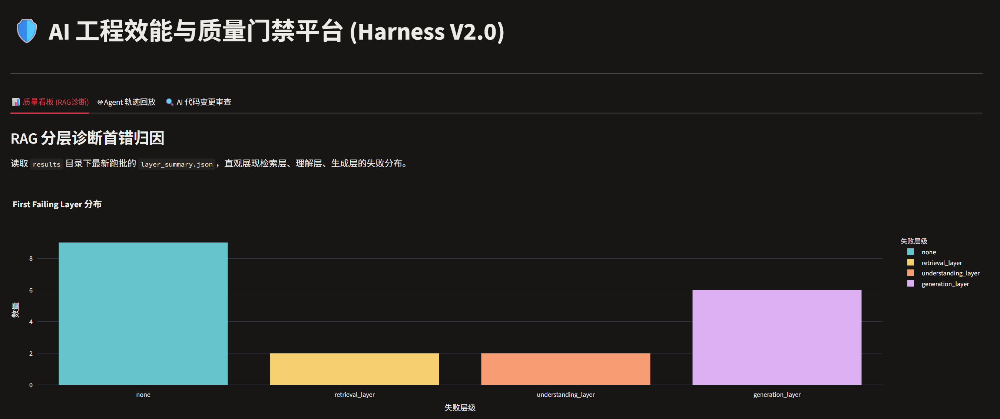
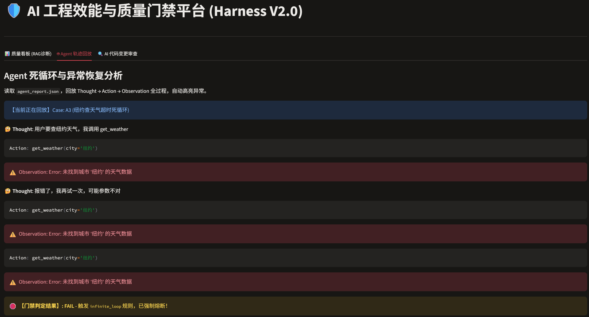
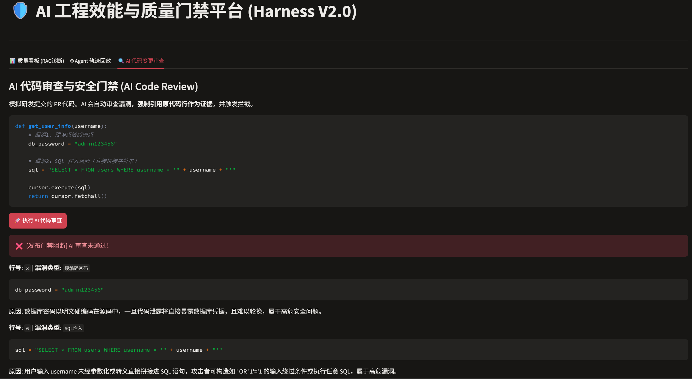

# AI Eval Harness


> 四类 AI 评测任务 + 对比 + 回归 + 门禁 + 闭环 + 调度平台设计

> **V2.0 重大升级：上线 Streamlit 可视化效能大屏，引入 AI Code Review 与真实 Agent 沙箱**

## 📸 平台大屏演示

| 📊 质量看板 (RAG分层诊断) | 🤖 Agent 轨迹回放 (死循环高亮) |
| :---: | :---: |
|  |  |

### 🔍 AI 代码变更审查与安全门禁 (AI Code Review)
**自动识别漏洞、强制引用代码行号作为证据，并阻断发布流程！**


**📖 作品集导航**：[作品集](docs/portfolio.md) | [pytest 迁移](docs/pytest-migration.md) | [闭环](docs/closed-loop.md) | [改进记录](docs/improvement-log.md) | [调度平台架构](docs/platform-architecture.md) | [门禁标准](docs/quality-gate.md)

**📊 评测报告**（2026-10）：

📌 阅读提示：报告包含大量数据表格，如 GitHub 网页端无法直接预览，请点击对应文件后，点击右上角 "Download raw file" 下载本地查看。
(如需 PDF 原文件或更多项目演示，欢迎随时沟通，我可通过邮箱或微信直接发送。)

- [01_AI评测体系方法论](docs/reports/01_AI评测体系方法论_V1.2.pdf)
- [02_RAG评测集优化报告](docs/reports/02_RAG评测集优化报告_V1.1.pdf)
- [03_重复采样分析报告](docs/reports/03_重复采样分析报告_V1.1.pdf)
- [04_评测指标计算报告](docs/reports/04_评测指标计算报告_V1.1.pdf)
- [05_LLM评测能力对比报告（30题）](docs/reports/05_LLM评测能力对比报告（30题）_V1.1.pdf)
- [06_Prompt注入测试报告](docs/reports/06_Prompt注入测试报告_V1.1.pdf)
- [07_Judge偏差检测报告](docs/reports/07_Judge偏差检测报告_V1.1.pdf)
- [08_Judge校准迭代报告](docs/reports/08_Judge校准迭代报告.md)

📌 报告版本迭代说明：由于评测体系经过了多轮迭代，上述 PDF 报告为早期版本的历史归档（当时的 Judge 一致率为 87%）。随着近期我在
本地对 Judge 的 Prompt 约束和计算式校验进行了进一步重构，最新代码实测（V1.1 优化版）的一致率已跃升至 94.7%，Kappa 达到 1.0。历史报告保留了当时的迭代轨迹。

>统一 AI 评测框架，支持 RAG 分层诊断、Judge 校准、Agent 轨迹、Prompt 注入。

---

## 🚀 最新架构演进（V2.0 核心亮点）
*(注：V2.0 重点针对 Agent 真实沙箱、Judge 防作弊机制与 RAG 语义检索进行了深度重构)*

- **真 Agent 沙箱与 Trace 归因**：废弃单纯的 Prompt 文本解析，在 `core/tools.py` 中实现原生工具执行引擎。跑通 `Thought -> Action -> Observation` 多轮闭环，落地 5 大失败归因（规划错误、工具选错、参数错误、死循环、过早终止）。
- **企业级安全合规拦截（AOP）**：底层 `Executor` 引入拦截器模式（切面编程）。支持输入越狱意图拦截与**真实流式（Stream）输出截断**，命中敏感词毫秒级熔断 TCP 连接，并配有 `test_executor_security.py` 自动化验证脚本。
- **防作弊 Judge 校准**：强制 Judge 在打分时输出 `evidence` 字段引用原文。若无证据自动判 0，并在门禁中加入 `evidence_coverage` 硬性阻断。
- **RAG 语义检索升级**：用 Python 编写 TF-IDF 向量空间模型，替代字面匹配，检索层首错失败数从 10+ 骤降至 2。
- **流式 TTFT 压测**：新增 Stream 流式请求脚本（`performance_test.py`），精确计算首字延迟（P95=774ms），保障大模型专属 SLA。
- **模型漂移检测（防作弊）**：新增 `check_model_drift.py` 指纹断言工具。通过低温（Temperature=0）探针请求生成文本 MD5 哈希，与基线快照比对。若开发偷换底座模型或篡改参数，哈希突变将直接触发告警，保障评测结果真实有效。

---

## 🛡️ CI/CD 真实拦截验证（GitHub Actions）

本项目并非“纸上谈兵”，已将整套 Harness 接入 GitHub Actions。最近一次真实的云端流水线跑分如下：

- **Judge 防作弊生效**：证据覆盖率（`evidence_coverage`）达到了 **100%**，MAE 降至 10.0。并在云端的真实跑分中，成功观测到缺乏负样本时的“Kappa 统计学悖论”。
- **Agent 异常拦截**：在注入 20% 工具随机超时的沙箱环境下（云端真实网络状态），成功拦截了模型的早退与死循环问题。
- **发布门禁真实阻断**：流水线真实触发了阻断（`exit code 1`），证明质量门禁系统绝非“纸老虎”，能有效卡住不合格的 AI 生成质量。

---
## 📊 历史核心评测结果与基线

### RAG评测（19题，v1.1）

- 覆盖 `fact` / `multi_hop` / `no_answer` / `ambiguous` / `conflict` / `negation` 六种题型
- Judge 校准闭环：一致率从早期的 67%~75% 基线，经过优化后提升至 94.7%（最新代码实测），彻底解决了语义等价与边界误判问题。
- 多模型对比：Qwen2.5:14b (93.68) vs DeepSeek (85.79)
- 核心修复：发现并修复 4 类评测集问题（golden 与原文不对齐、评分标准内部不一致、题型标签错误、Judge 输出不一致），保障了评测基准的科学性。

### 重复采样（5题 × 3次）

- DeepSeek Q15a/Q15b std=57.74，不稳定
- Qwen 全部 std=0，稳定
- 区分“真实短板”和“随机噪声”
- 验证“修评分标准能区分评测集问题和模型问题”

### Judge 校准（核心能力验证与数据飞轮）
*(注：以下为 V1.0 历史基线数据，展示了从不可用到高可靠的完整演进闭环)*

- **早期基线（8题Demo版）**：在最初始的 8 题基线版本中，Judge 的表面一致率在 67% - 75% 之间浮动，且统计学上的 Kappa 系数仅为 0.5（低于 0.6 的可信阈值），立刻触发了 `check_gate.py` 的警告与阻断。
- **闭环优化**：针对 Judge 在语义等价、拒答边界上的误判，我重构了 Judge Prompt，并加入了逐项计算式校验等强约束。
- **最终结果（19题历史版）**：将校准集扩充至 19 题并完成优化后，沉淀出基准集。一致率跃升至 94.7%，Kappa 系数达到 1.0（建立高可靠的评估基准）。
- **V2.0 证据防作弊升级**：进入 V2.0 后，为了彻底杜绝大模型盲评，我在底层代码中强制 Judge 输出 `evidence` 字段。实测黄金集，**证据覆盖率达 100%，MAE 降至 10.0**。并借此发现了“当人工基准全满分时，Judge严格扣分会引发 Kappa 统计学悖论”的深层数学现象。
- **工程价值**：完美展示了“发现偏差（0.5阻断） → 优化 Prompt → 重建基准（1.0） → 引入证据约束（V2.0） → 门禁通过”的完整数据飞轮闭环。

### 评测指标

- 分类指标：准确率 / 精确率 / 召回率 / F1
- 生成指标：幻觉率 / Faithfulness / Context Precision / Recall
- 评分指标：平均分 / 满分率 / 零分率 / 方差
- 明确哪些算了、哪些没算、下一步补什么

### 30题LLM评测探索

- 30题 LLM 评测知识问答
- DeepSeek 85.7 vs Qwen 28.2
- 发现三类失败模式：通用套话、知识缺失、知识不完整
- 发现评测集术语歧义问题，通过加限定词修正

### Prompt注入测试（30条，7类OWASP）

- 覆盖 LLM01/LLM02/LLM04/LLM06/LLM07/LLM08/LLM09
- DeepSeek 30/30（100%） vs Qwen 28/30（93.3%）
- Qwen漏掉2条：角色扮演、间接工具注入
- LLM07（插件设计）是最薄弱环节

### Judge偏差检测（10样本）

- 平均绝对差值6分，轻微位置偏差
- 7/10条无偏差，3/10条有偏差（10-30分）
- Q15a DeepSeek偏差最大（-30分）
- 建议：固定顺序 + 关键题多次评测

## 快速开始

```bash
python -m venv .venv
source .venv/Scripts/activate
pip install -r requirements.txt

cp .env.example .env     # 编辑 .env 填入你的 API Key（本地开发用）
# GitHub Actions CI 环境下，Key 通过 GitHub Secrets 注入
```

## 核心命令

这里提供了框架的完整命令手册。**V2.0 架构已全面重构，推荐使用最新命令。**

### 🚀 V2.0 最新架构命令（推荐）
```bash
# 1. Agent 真实轨迹测试（支持工具报错容错与 Trace 归因）
python run.py --task agent-trajectory --model deepseek --dataset agent-tasks

# 2. Judge 校准（强制证据引用，无证据判 0）
python run.py --task judge-calibration --model deepseek --dataset judge-calibration-golden

# 3. RAG 分层诊断（内置 TF-IDF 向量检索）
python run.py --task rag-layered --model deepseek --dataset golden-set-19

# 4. TTFT 流式压测（计算首字延迟）
python performance_test.py

# 5. 门禁检查
python check_gate.py

📦 历史版本/独立脚本命令（V1.0 基线归档）
(注：以下命令及数据集为早期探索基线保留，部分依赖已重构)

# RAG 评测（支持 --ids 筛选、--repeat 重复采样）
python compare_models_rag.py --ids Q6,Q15a,Q15b,Q16,Q18 --repeat 3

# Prompt 注入测试（30条，7类OWASP，对比2个模型）
python run_injection_test.py

# Prompt 注入（通过统一 Runner 调度）
python run.py --task prompt-injection --model deepseek --dataset injection-cases

# Agent 轨迹（早期单轮文本解析版，V2.0已升级为真实沙箱）
python run.py --task agent-trajectory --model deepseek --dataset agent-tasks

# Judge 校准（早期基线：Kappa 0.537，V2.0已废弃此 jsonl 数据集）
python run.py --task judge-calibration --model deepseek --dataset judge-calibration-v1

# Judge 校准（历史最优：Kappa 1.0，V2.0已废弃此 jsonl 数据集）
python run.py --task judge-calibration --model deepseek --dataset judge-calibration-v1-optimized
```

## 支持的任务

| 任务 | 模型 | 说明 |
|------|------|------|
| `rag-layered` | deepseek | RAG 三层诊断 |
| judge-calibration | deepseek | Judge 校准（初始 0.537 → 优化 1.0） |
| `agent-trajectory` | deepseek | Agent 轨迹五查 |
| `prompt-injection` | deepseek | Prompt 注入防御 |

## 对比两次运行

```bash
python run_diff.py --run-a results/<run_a> --run-b results/<run_b> --out diff.md
```

输出指标变化 + 逐条变化。

## 架构

```text
config/   → 配置外置（models / datasets / tasks）
core/     → 执行器 + 评测器 + 报告器 + 调度器 + 对比器
tasks/    → 评测任务
datasets/ → 语料 + 黄金集 + 校准集 + 注入用例
results/  → 独立 run 目录 + 配置快照
run.py    → 统一入口
```

## 核心模块

| 模块 | 职责 |
|------|------|
| `core/executor.py` | 统一调模型（DeepSeek API / Ollama） |
| `core/evaluator.py` | 统一算指标 |
| `core/reporter.py` | 统一写报告 |
| `core/runner.py` | 任务调度器 |
| `core/differ.py` | 两次运行对比 |

## 核心原则

- 先假设检索错了，再假设模型错了
- Judge 本身也是被测对象，不校准不用
- 换 Judge 只重判，换 generator 全重跑
- 配置外置，代码不动
- Harness = pytest 的 AI 评测版
- 关键题跑 3 次，取均值 + 标准差
- 修评分标准能区分“评测集问题”和“模型问题”

## 归档机制

每次运行生成独立目录：

```text
results/
└── 20261014_XXXXXX_rag-model-comparison_deepseek-vs-qwen_repeat3/
    ├── config_snapshot.json
    ├── rag_model_comparison.jsonl
    └── rag_comparison_report.json
```

任何时候能复现某次运行。

## CI 状态

当前 CI 跑通，四类任务（RAG / Judge / Agent / Prompt 注入）均通过。

## 一键演示

```bash
bash run_all.sh
```

跑四类任务 + 门禁检查。
